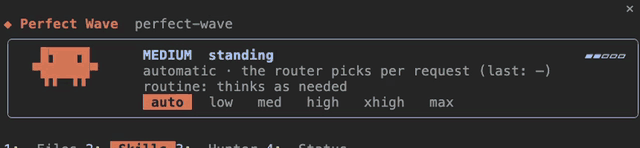
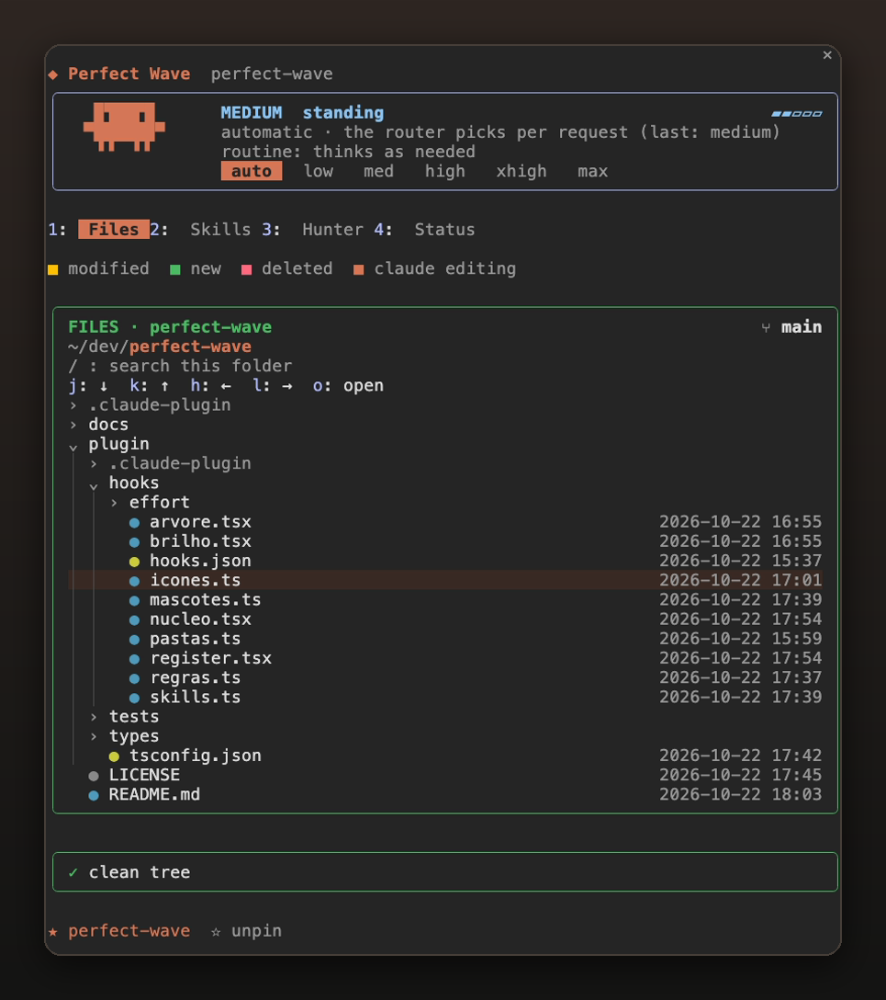

<p align="center">
  
</p>

<h1 align="center">Perfect Wave</h1>

<p align="center">
  <em>One pane beside Claude Code. Ride the session instead of chasing it.</em>
</p>

<p align="center">
  
  
  
</p>

<p align="center">
  
</p>

Perfect Wave is a [Claude Code](https://claude.com/claude-code) mod that docks a pane beside the chat. The pane has four tabs: a live file tree that follows the session, a browser for every skill you have, a skill hunter that reviews a skill before it installs it, and a session dashboard with cost, context and limits. Underneath, an effort router sets the effort of each request from how hard the prompt is, and the engine enforces a few git guardrails.

Everything runs inside Claude Code's mod engine: no daemon, no extra process, no network calls except the ones you trigger in the Hunter.

---

## Contents

- [Install](#install)
- [The pane](#the-pane)
- [Files](#files)
- [Skills](#skills)
- [Hunter](#hunter)
- [Status](#status)
- [Effort router](#effort-router)
- [Guardrails](#guardrails)
- [Commands](#commands)
- [Files it reads and writes](#files-it-reads-and-writes)
- [Develop](#develop)
- [Known limits](#known-limits)

---

## Install

```bash
claude plugin marketplace add jpazv/perfect-wave
claude plugin install perfect-wave@perfect-wave --scope user
```

Restart Claude Code (or run `/reload-plugins`). To try it without installing:

```bash
git clone https://github.com/jpazv/perfect-wave
claude --plugin-dir ./perfect-wave/plugin
```

## The pane

The pane opens by itself beside the chat when the terminal is wide enough (the engine places an unrequested side pane from about 144 columns). On a narrower terminal, open it with `/wave`. It also works in the Claude Code desktop app.

At the top sits the **effort card**: Clawd, the Claude Code mascot, acts out the current effort, and the row of buttons (`auto low med high xhigh max`) pins a level from the next request on. Below it are the tabs; press `1`–`4` while the pane has focus, click them, or open one directly with `/wave <tab>`.

<p align="center">
  
</p>

## Files

<p align="center">
  
</p>

A file tree in the style of an editor explorer, built for watching what Claude does.

- **Follows the session.** The root is the session's working directory and moves when Claude `cd`s somewhere else. Navigating by hand sticks until the next `cd`.
- **Reveals what Claude touches.** When Claude reads or edits a file under the root, its folders open and the cursor jumps to it. While the tool runs, the row glows in Claude's color and gets a `●` marker.
- **Git at a glance.** Each row shows its status: `+added −removed` lines and the porcelain code (`M`, `A`, `D`, `??`) for files, and `M:n` (changed files inside) for folders. Yellow is modified, green new, red deleted. The card title shows the branch with `↑ahead ↓behind`, or `no upstream`.
- **Receipt.** Under the tree, one line sums the working tree: `3 modified · 1 new · 0 deleted · +42 −7`, or `clean tree`.
- **Change log.** The last changes seen by the poller, with time and type (`new`, `modified`, `deleted`). Files that just changed flash for four seconds.
- **Keys.** `j`/`k` move, `l` opens a folder, `h` closes it or goes up, `o` acts on the selection. Clicking a folder toggles it; clicking a file inserts `@path` into your prompt so you can hand it to Claude.
- **Search.** `/` filters the visible tree by name.
- **Pins.** `+ pin this` keeps a folder in the bottom bar for one-click jumps.
- **Icons.** With a Nerd Font installed, files get colored type icons and folders get folder glyphs; without one, plain colored markers.

Folders with more than 300 entries are not expanded, and `node_modules`, `.git`, `dist`, `.next`, `coverage` and `__pycache__` are skipped.

## Skills

<p align="center">
  
</p>

Every skill and command you have installed (built-ins excluded), in one place.

- **Groups.** Skills are sorted into Firecrawl, Marketing, Design, Documents, Code and Other by name and plugin. Each group is a tile with its count; click a tile to list it.
- **Search.** The search box matches name and description across all groups at once (`14 of 101 skills`).
- **One click to use.** Clicking a skill writes `/skill-name ` into your prompt, ready for arguments.
- `/wave skills <filter>` opens the tab already filtered.

## Hunter

<p align="center">
  
</p>

Find new skills without installing something you have not read.

1. **Search.** Type what you need, or run `/wave hunter <term>`. The pane queries the public [skills.sh](https://skills.sh) index (the one behind `npx skills find`) through its JSON API and lists up to 15 results by install count. Nothing is executed.
2. **Review.** `⌕ review` downloads only that skill's `SKILL.md` from GitHub into `~/.cache/perfect-wave/review/` and fills your prompt with a review request. Claude reads it and flags data exfiltration, network commands or `curl | sh`, credential requests, attempts to turn protections off, or scripts that run on their own. You get a verdict before anything is installed.
3. **Install.** The `↓ install` button only appears after a review, and it still asks for confirmation. It runs `npx skills add <source> --skill <id> -a claude-code -g -y` with `DISABLE_TELEMETRY=1` and `DO_NOT_TRACK=1`, then refreshes the Skills tab.

Each result card shows its state: `○ not reviewed`, `◐ reviewed`, `✓ installed`.

## Status

<p align="center">
  
</p>

A dashboard of the current session, built from what the engine reports and from the usage of each response. Nothing is estimated unless it says so.

| Card | What it shows |
|---|---|
| **Session** | Cost, total tokens, turns, agent time, time per turn, cache hit rate. |
| **Context** | Context window usage with a bar, and the five biggest categories (messages, system tools, MCP tools, skills, memory files). |
| **Limits and cost** | Your plan's 5-hour and weekly windows with usage bars and time to reset. |
| **Savings** | Insights from measured numbers: tokens served from cache and what they saved, how many requests the router adjusted, average output per effort, cost per turn, a warning when the cache hit rate drops below 70% or the context passes 70%, and the 5-hour burn rate with an estimate of when you hit the limit at this pace. Lines wrap, so nothing gets cut off. |
| **Ponytail** | If you use [Ponytail](https://github.com/DietrichGebert/ponytail): switch its level for this session (fills `/ponytail <level>`), set the default level for new sessions, and toggle its status bar and startup notice. Writes `~/.config/ponytail/config.json` and keeps every other field in it. |
| **Tokens this session** | Input, output, cache read, cache write, and the side classifier's own calls and tokens, kept apart. |
| **By effort** | Requests and average output per effort, plus a sparkline of the last 30 responses colored by effort. |
| **Recent requests** | The last eight prompts with the effort they ran at and how long they took. |

## Effort router

The router changes only the `effort` field of each main-conversation request. It never switches the model, because the prompt cache is tied to the model: a model switch re-sends the whole conversation, while an effort change keeps the cache hit.

**How a prompt is scored**

- Risk and architecture words (auth, migration, deploy, database, security, delete, refactor…) weigh the most.
- Code words, file paths and file names add a little; "all files", "every", "whole project" add breadth.
- Long prompts and many lines add a little.
- Plain text work (translate, rewrite, summarize, define) and git or board chores (commit, push, comment, move a card) subtract.
- English and Portuguese keywords are both recognized.

**What it does with the score**

| Score says | Effort | Notes |
|---|---|---|
| Plain text or chore | `low` | `medium` if the prompt has an attachment |
| Routine code | `medium` | |
| Heavy or risky | `high` | Claude is also asked for a short plan before changing anything |
| Unclear, no risk | asks Haiku | One 5-token call with no history, so the main cache is untouched; on failure it keeps the current effort |
| Unclear, with risk | `high` | |
| Bare approval ("ok", "go on") | inherits | After a heavy task's plan is approved, execution runs at `medium` |

In `auto` it never goes above `high`; `xhigh` and `max` are used only when you pin them.

**Safety net.** If a turn that ran at a lowered effort takes more than 10 steps or hits 2 tool errors, the router stops lowering for the next 3 turns and your own `/effort` comes back.

**What it never touches.** Subagent requests, messages from other sessions, input typed while another turn is running, and numeric efforts you set by hand.

Every change is announced once with its direction (`Wave effort: low ↓ | simple (text transformation)`), and the status line shows what the last request used.

## Guardrails

Checked by the engine before a tool runs (`tool.check`), so they apply even in auto mode:

| Action | Result |
|---|---|
| `git push --force`, `-f`, `--force-with-lease`, `--mirror`, `+branch` refspecs | **Denied** |
| `git push` to `main` or `master` (including `HEAD:main`, `refs/heads/master`) | **Asks** |
| `gh pr merge` | **Asks** |
| Launching a subagent or workflow (`Agent`, `Task`, `Workflow`) | **Asks**: a subagent can spend tens of thousands of tokens in seconds |

Commands are parsed by segment (`&&`, `;`, `|`), so `cd x && git push -f` is caught and `echo "git push --force"` is not.

## Commands

```text
/wave                                    open the pane
/wave files | skills | hunter | status   open on a tab
/wave skills <filter>                    open Skills filtered
/wave hunter <term>                      search skills.sh right away
/wave-effort auto                        let the router decide (default)
/wave-effort low|medium|high|xhigh|max   pin a level from the next request
/wave-effort inherit                     use your own /effort, no routing
/wave-effort off                         router off
/wave-effort status                      requests, adjusted, tokens, classifier calls
```

## Files it reads and writes

| Path | Why |
|---|---|
| The session's working directory (read only) | File tree, `git status`, `git diff --numstat` |
| `~/.cache/perfect-wave/review/` | `SKILL.md` files downloaded for review |
| `~/.claude/skills/` (via `npx skills add`) | Only when you confirm an install |
| `~/.config/ponytail/config.json` | Only when you change a Ponytail setting |
| `~/.claude/.ponytail-active` (read only) | Ponytail's current level |

## Develop

```bash
claude plugin validate ./plugin
claude plugin test ./plugin        # 44 tests: rules table, effort policy, pane rendering
```

```text
plugin/
  hooks/register.tsx     pane rendering, commands, guardrails
  hooks/nucleo.tsx       shared state, folder polling, hunter, usage counters
  hooks/effort/          effort router (policy.js is pure and table-tested)
  hooks/regras.ts        guardrail verdicts (pure)
  hooks/pastas.ts        tree flattening, git status parsing
  hooks/arvore.tsx       animated tree (client module)
  tests/
```

## Known limits

- The engine has no file watcher, so the Files tab polls only the open folders every 2 s and runs `git status` every 10 s.
- `git push` with no destination while on `main` is not detected; only explicit destinations are.
- Side pane placement depends on terminal width; on narrow terminals the pane opens over the chat.

## License

MIT
