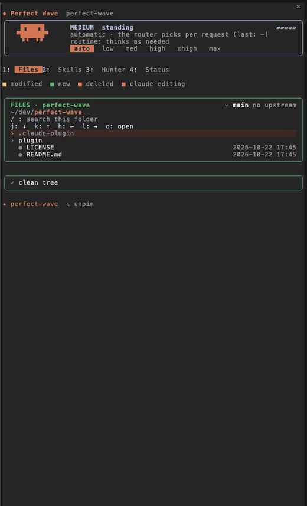
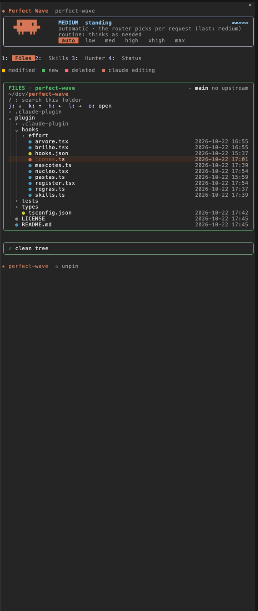
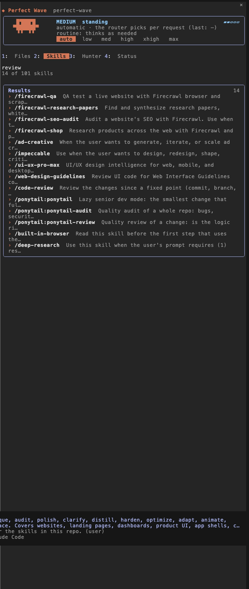
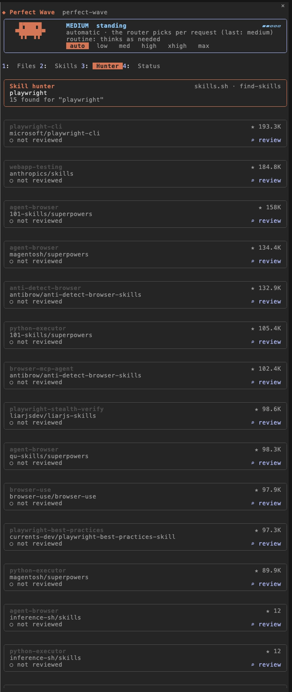
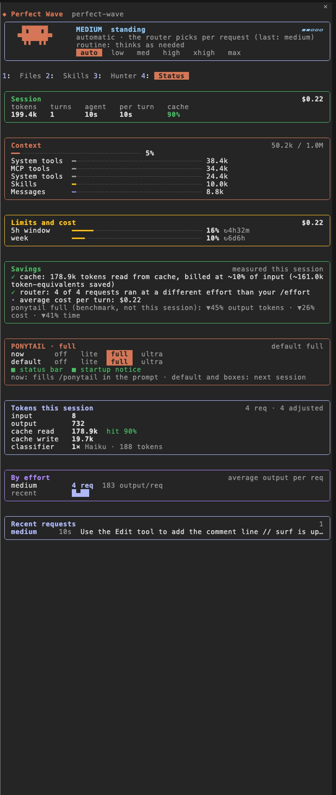
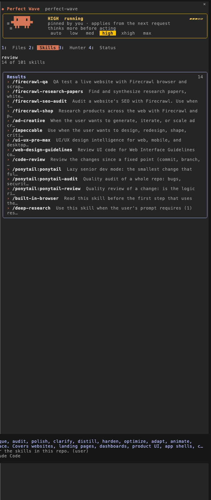
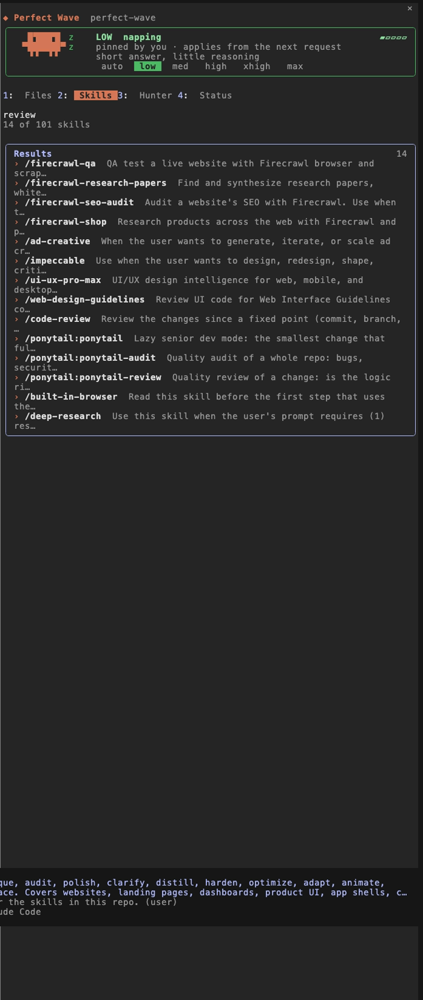

# Perfect Wave

A side pane mod for [Claude Code](https://claude.com/claude-code). One pane, four tabs: a live file tree, every skill you have, a skill hunter with a review step, and a session dashboard. On top of that, an effort router that picks the reasoning effort per request and a few git guardrails enforced by the engine.

<p align="center"></p>

## What's inside

| Part | What it does |
|---|---|
| **Files** | Live tree of the session's folder (follows `cd`). Git marks per file and folder (`+/−` lines, `M:n`), branch with ahead/behind, a change log, and the file Claude is editing highlighted while it works. Click a file to insert `@path` in the prompt. Keys `j k h l o`, search with `/`, pin folders. |
| **Skills** | Every skill and command grouped (Firecrawl, Marketing, Design, Documents, Code, Other). Search by name or description; click to fill `/skill` in the prompt. |
| **Hunter** | Searches [skills.sh](https://skills.sh) through its JSON API without running third-party code. **Review** downloads only the `SKILL.md` and asks Claude for a verdict; **Install** only shows up after a review and still asks for confirmation (`npx skills add … -g`, telemetry off). |
| **Status** | Session cost, tokens, turns, cache hit rate, context breakdown, 5h/week limits with reset time and burn rate, measured savings, effort usage, recent requests, and a Ponytail card to switch its level and defaults. |
| **Effort router** | Scores each prompt (risk, code, breadth, length) and sets the effort for that request without ever changing the model, so the prompt cache survives. Plain text and chores go down, heavy tasks go up and get asked for a plan first. A lowered turn that struggles pauses lowering for a few turns. Pick a level by hand in the pane or with `/wave-effort`. |
| **Guardrails** | Through `tool.check`: force push is **denied**; `gh pr merge` and pushes straight to `main`/`master` **ask**; launching a subagent **asks**. |

## Screenshots

<table>
<tr>
<td width="50%"><b>Files</b>: git marks and the file Claude is touching<br></td>
<td width="50%"><b>Skills</b>: search across every skill<br></td>
</tr>
<tr>
<td><b>Hunter</b>: search, review, then install<br></td>
<td><b>Status</b>: cost, context, limits, savings<br></td>
</tr>
<tr>
<td><b>Effort</b>: pinned at high<br></td>
<td><b>Effort</b>: pinned at low<br></td>
</tr>
</table>

## Install

```bash
claude plugin marketplace add jpazv/perfect-wave
claude plugin install perfect-wave@perfect-wave --scope user
```

The pane opens on its own beside the chat when the terminal is wide enough (about 144 columns); otherwise open it with `/wave`.

## Commands

```text
/wave [files|skills|hunter|status]   open the pane on a tab
/wave skills <filter>                open Skills filtered
/wave hunter <term>                  search skills.sh right away
/wave-effort [auto|low|medium|high|xhigh|max|inherit|off|status]
```

Inside the pane, `1`–`4` switch tabs.

## Develop

```bash
git clone https://github.com/jpazv/perfect-wave
claude --plugin-dir ./perfect-wave/plugin      # try it without installing
claude plugin validate ./perfect-wave/plugin
claude plugin test ./perfect-wave/plugin
```

## Known limits

- The engine has no file watcher: the Files tab polls only the open folders every 2 s.
- `git push` with no destination while on `main` is not detected (only explicit destinations).
- The Ponytail card reads and writes `~/.config/ponytail/config.json`; without Ponytail installed it simply shows the defaults.

## License

MIT
